# Amplify: Campaign Amplification Platform (hackathon prototype)

Community-funded message amplification. Backers pay toward the **advertising cost** of a campaign; it is **not a donation** to the cause. This repo is the mobile prototype plus the backend that powers it.

```
backend/   Node 22 + Express + zod + SQLite (node:sqlite). Lifecycle, fees, reach model, review API, simulated payments
mobile/    React Native + Expo (SDK 57, expo-router, TypeScript)
```

## Screenshots

Android build against the live API. [Download the APK](https://github.com/Kryptonnnnnn/campaign-amplification/releases/download/v1.0.0/amplify-prototype.apk) or [watch the 2½-minute walkthrough](https://github.com/Kryptonnnnnn/campaign-amplification/releases/tag/v1.0.0) (both attached to the v1.0.0 release).

<table>
<tr><td align="center" width="33%">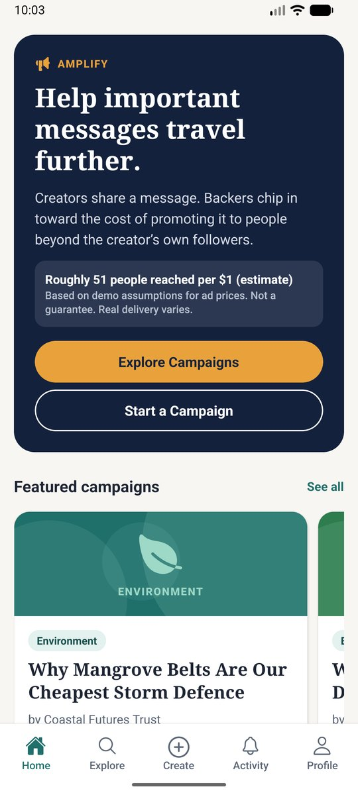<br><sub>Home: hero, reach per $1 estimate, featured</sub></td><td align="center" width="33%">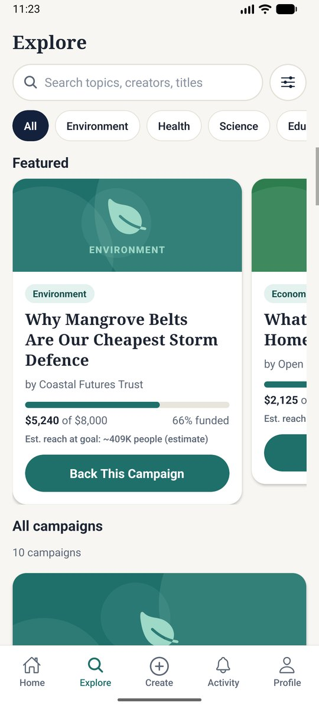<br><sub>Explore: search, categories, featured</sub></td><td align="center" width="33%">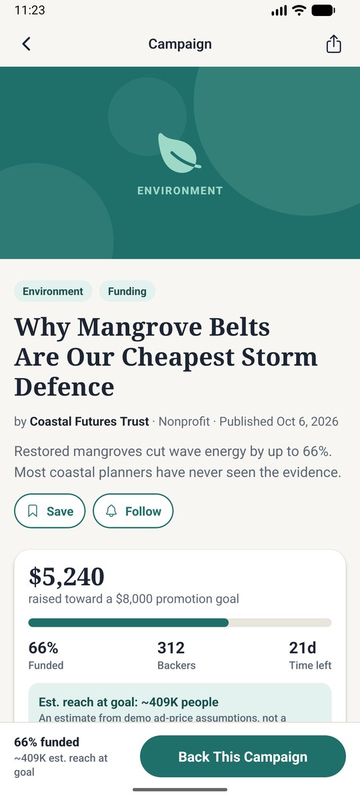<br><sub>Campaign page: funding, reach estimate</sub></td></tr>
<tr><td align="center" width="33%">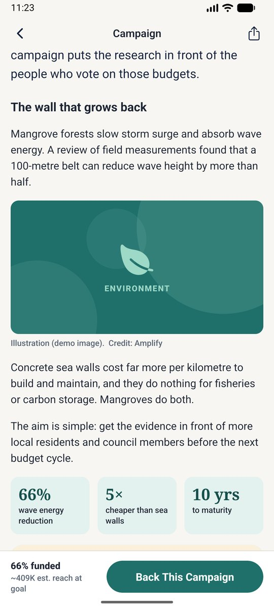<br><sub>Story with visible sources</sub></td><td align="center" width="33%">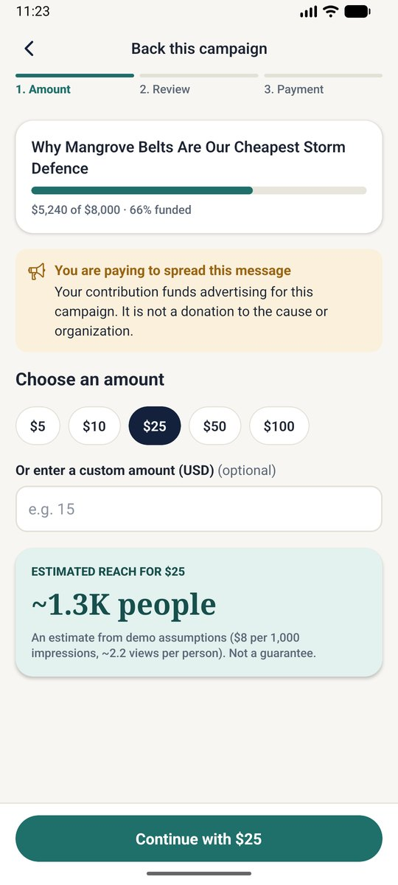<br><sub>Back: amount + live reach estimate</sub></td><td align="center" width="33%">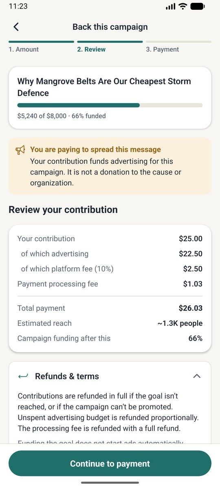<br><sub>Back: fee breakdown before paying</sub></td></tr>
<tr><td align="center" width="33%">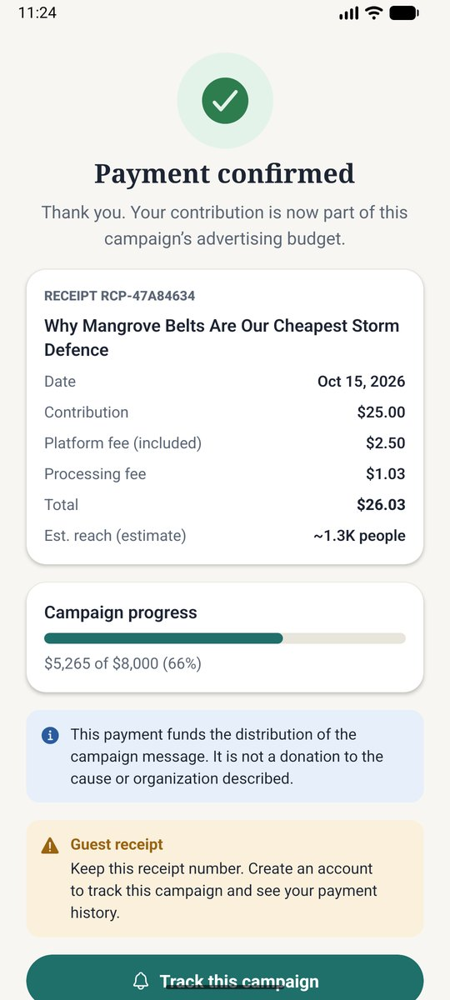<br><sub>Payment confirmed + receipt</sub></td><td align="center" width="33%">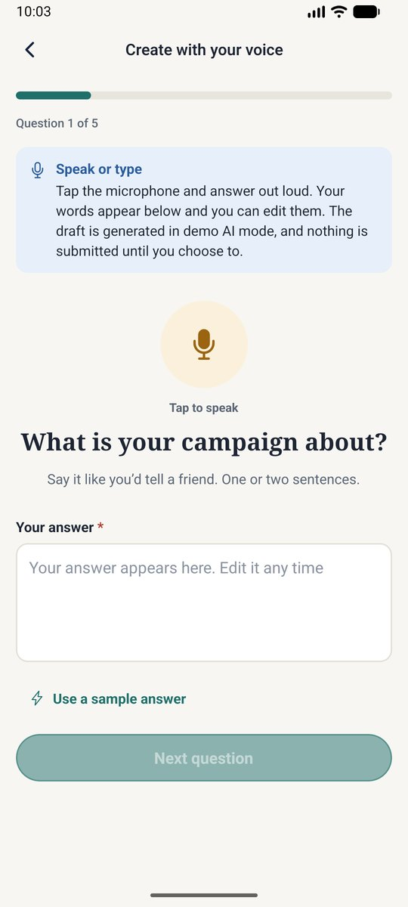<br><sub>Create with your voice</sub></td><td align="center" width="33%">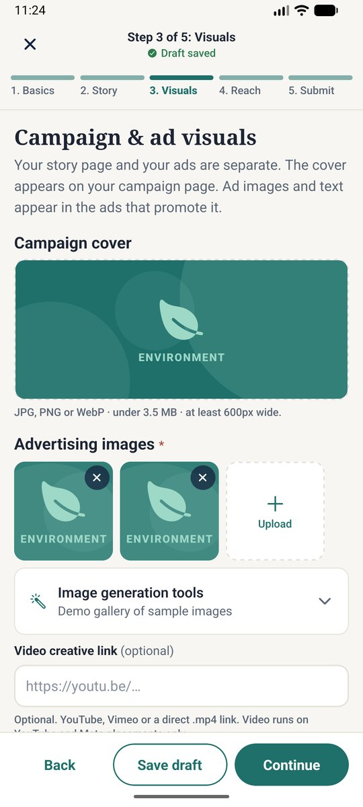<br><sub>Step 3: ad visuals + placement previews</sub></td></tr>
<tr><td align="center" width="33%">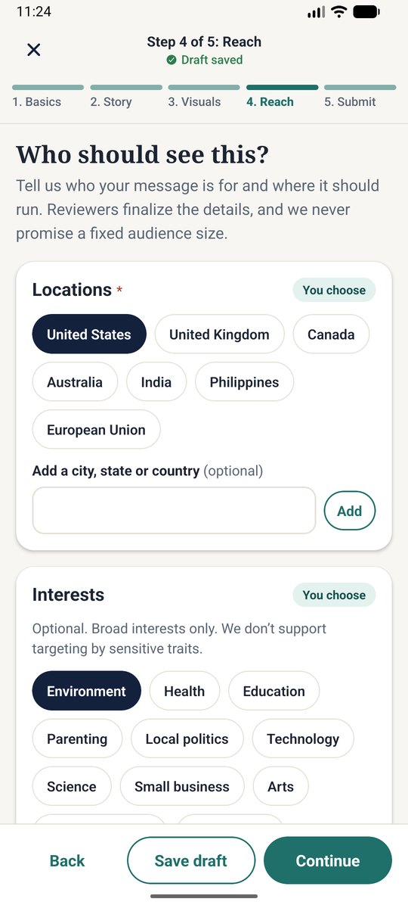<br><sub>Step 4: reach + audience preview</sub></td><td align="center" width="33%">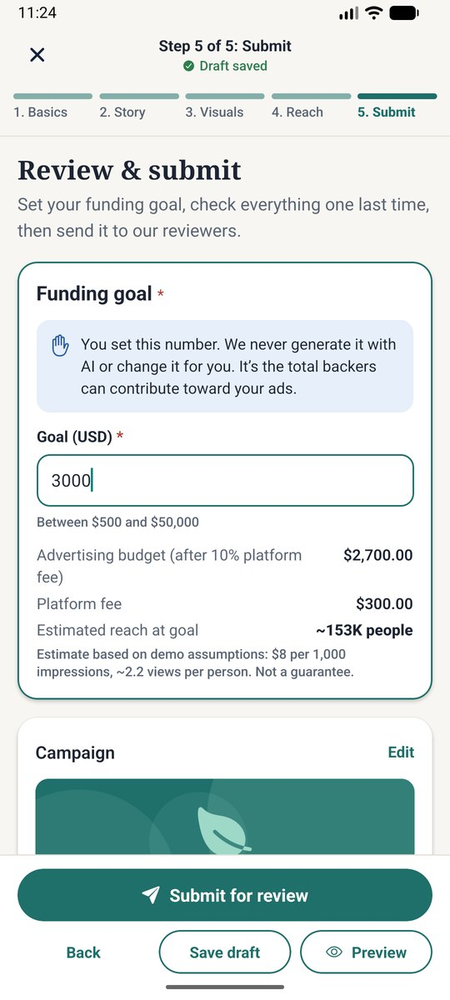<br><sub>Step 5: creator sets the goal</sub></td><td align="center" width="33%">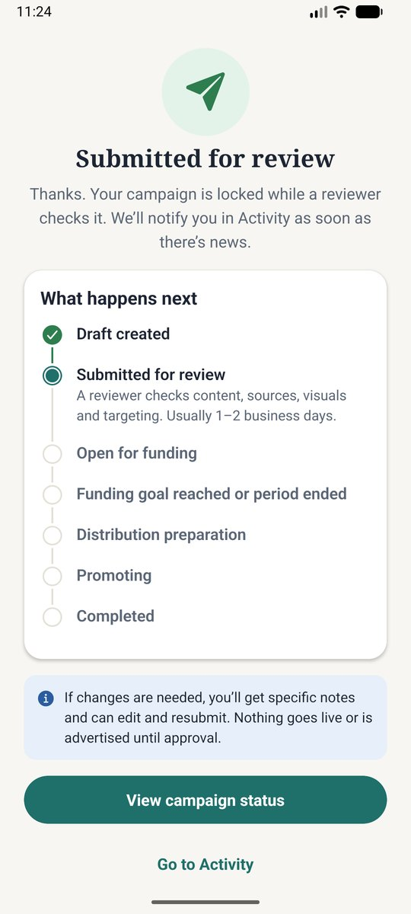<br><sub>Submitted: status timeline</sub></td></tr>
<tr><td align="center" width="33%">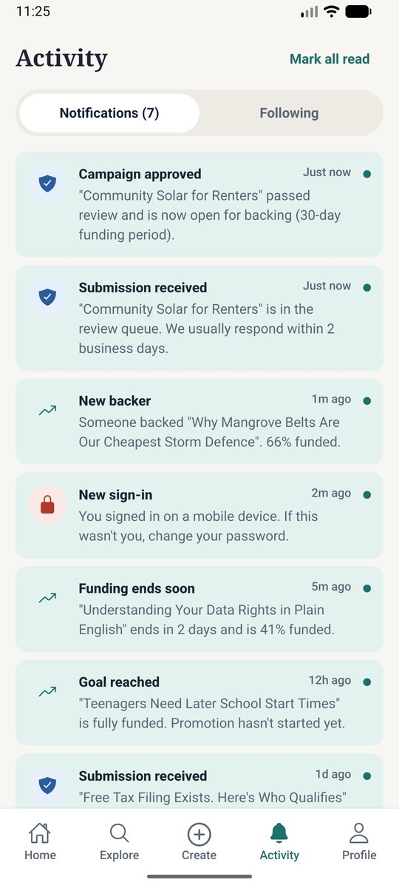<br><sub>Activity: notifications</sub></td><td align="center" width="33%">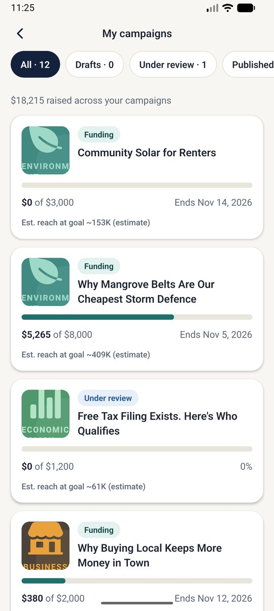<br><sub>Creator dashboard</sub></td><td align="center" width="33%">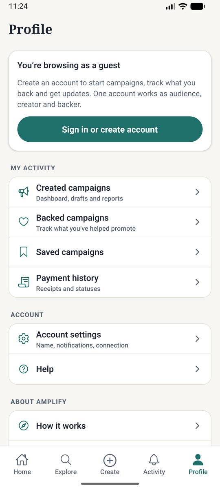<br><sub>Profile and secondary pages</sub></td></tr>
</table>

## Run it

```bash
# 1. API (Node 22+, no native deps). Seeds demo data on first start.
cd backend && npm install && npm start            # http://localhost:4000
npm run seed                                      # wipe + re-seed anytime

# 2. App
cd mobile && npm install && npx expo run:android # dev build (needs Android SDK). Expo Go won't work: the app uses a native speech module
```

**Live API:** `https://amplify-api-cvuq.onrender.com` (Render free plan: it sleeps after ~15 min idle, so the first request can take 30-60 s, and demo data re-seeds on restart). The release APK is built against it, so it works on any phone with internet. Reviewer console: `https://amplify-api-cvuq.onrender.com/admin-ui/`.

**Local development:**  the phone can't reach `localhost`. Either set `EXPO_PUBLIC_API_URL=http://<your-LAN-IP>:4000`, or change the server in *Profile → Account settings → Connection*. Android emulator uses `10.0.2.2:4000` automatically.

**Demo accounts** (password `demo1234`): `demo@amplify.demo` (backer history), `creator@amplify.demo` (owns every seeded campaign, drafts, one under review), `admin@amplify.demo` (reviewer).

**Reviewer console:** `http://localhost:4000/admin-ui/` (approve / request changes / reject, advance lifecycle, audit log). Not part of the mobile nav, per the brief.

## Demo

1. **Home → Explore**: browse as a guest, search "mangrove", filter by category, sort, open filters.
2. **Campaign detail**: story, visible sources, Use of funds, Audience, Review & trust, feedback.
3. **Back it as a guest**: amount → live reach estimate → fee review → simulated checkout (`4242…` succeeds, `4000 0000 0000 0341` pending, `4000 0000 0000 0002` declined) → receipt.
4. **Create** (sign in as `demo@`): 5 steps with autosave, validation, ad previews, preview, set goal on step 5, submit → status timeline.
5. **Reviewer console**: approve it. Back in the app, Activity shows the notification and the campaign is live.
6. Back it to goal in the app → status becomes *Goal reached* (**ads do not start**). In the console: Start distribution prep → Authorize promotion (blocked unless approval, settled payments, budget, creative and channels are all in place) → Simulate delivery → Mark completed → **Report** screen (funds vs estimated vs measured).

## Key decisions

- **State machine on the server** (`backend/src/lifecycle.ts`). Goal reached → `goal_reached` → `distribution_prep` → `promoting`. Funding never auto-launches ads.
- **Creator sets the goal**: only `PUT /campaigns/:id { goalCents }` can write it; nothing else touches it.
- **Estimates vs measured** are separate everywhere. One config object (`backend/src/config.ts`) drives all reach numbers (CPM, frequency, fees); the app mirrors it from `/meta`.
- **Privacy**: backers anonymous by default (opt-in name); card numbers are never stored; guests get a receipt token; roles enforced server-side (`requireAdmin`, owner checks).
- **Autosave** (`mobile/src/draft/DraftContext.tsx`): local-first edits, 800 ms debounce, flush on navigation, retry on failure. Drafts tolerate partial data; strict validation runs at submit.
- **Honest fallbacks**: voice creation uses keyboard dictation + demo AI (labelled "Demo"); image generation is a sample gallery; payments are simulated; ad delivery is simulated.

## What's in it

Everything in the hackathon brief's required scope, plus the optional items:

- **Discover:** Home (hero, estimated reach per $1, featured, feed, Create → Review → Amplify), Explore (search, categories, featured, sort, filters, loading / empty / error / no-results states).
- **Create (5 steps):** Basics → Story → Visuals → Reach → Submit with a persistent stepper, autosave, resume, validation, ad placement previews, audience preview, full preview, creator-set goal, confirmation timeline. Story composer has reorderable blocks, bold / italic / bullets, images with captions and credits, stats, sources and actions.
- **Voice creation:** real on-device speech-to-text (`expo-speech-recognition`), answers land in an editable draft. Typing always works as a fallback.
- **Back a campaign:** presets / custom amount, live reach estimate, fee breakdown, simulated checkout with every state (succeeded, pending, failed, rejected, cancelled, refunded), guest checkout, receipts, anonymous by default.
- **Creator tools:** dashboard with status tabs, manage screen, campaign updates, cancel (refunds are tracked and issued by a reviewer), change requests for live campaigns, backer activity (amounts and timing only), final reports with estimated vs measured numbers kept apart.
- **Community:** comments and replies with reporting, deletion, link / profanity blocking, rate limiting, first-name-plus-initial privacy and reviewer moderation.
- **Notifications:** in-app feed and per-category preferences; submission, review decisions, approval, funding milestones, goal reached, "ends soon" (scheduled), payment results, promotion start and progress, completion, updates, security.
- **Info pages:** Partners, About, How it works, FAQs, Help, Contact, Terms, Privacy, Community Guidelines.
- **Reviewer console** (`/admin-ui/`): approve / request changes / reject, advance the lifecycle, issue refunds, resolve change requests, moderate comments, audit log.


## Known limitations

- Payments, ad delivery and AI drafting are simulated or demo-mode by design. Image generation is a sample gallery.
- SQLite instead of Postgres. The schema is plain SQL and ports directly to Postgres / Supabase.
- No push or email delivery; notifications are in-app only.
- Tested on an Android emulator (API 36, arm64) including a small-screen size. Not tested on iOS or a physical device.
- Uploaded images are stored on the API server's disk. Use object storage for production.

## Deploy the backend

`render.yaml` is a one-click Render blueprint (Docker, free plan, `JWT_SECRET` generated). On the free plan the disk is ephemeral, so demo data re-seeds on each restart. Then set the deployed URL in `mobile/eas.json` (`preview.env.EXPO_PUBLIC_API_URL`) or in the app under *Profile → Account settings → Connection*.

## Build the APK

A prebuilt arm64 APK is attached to the GitHub release as `amplify-prototype.apk` (works on the Android emulator against a backend on the host machine; point it at a hosted backend for real devices).

Local build without EAS: `cd mobile && npx expo prebuild --platform android && cd android && ./gradlew assembleRelease -PreactNativeArchitectures=arm64-v8a` (needs JDK 17 + Android SDK; first run ~20 min). Add `x86_64`/`armeabi-v7a` for other devices.

Or with EAS:

```bash
cd mobile
# deploy backend somewhere reachable first, then put its URL in eas.json (preview.env.EXPO_PUBLIC_API_URL)
npx eas-cli login && npx eas-cli build -p android --profile preview     # produces an installable .apk
```

(Backend needs Node 22+; any host that runs `npm start` works: Render, Railway, Fly.)
